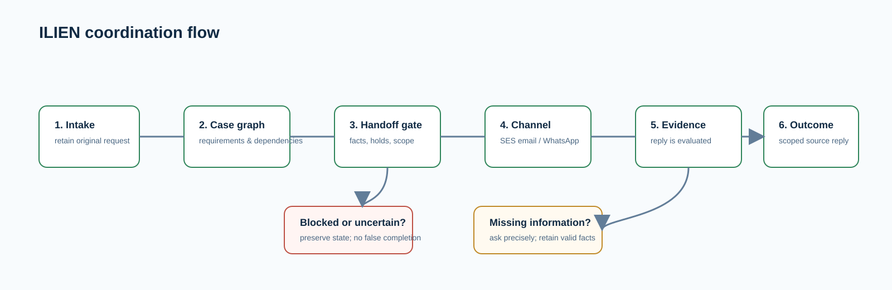

# ILIEN

ILIEN coordinates time-sensitive textile exceptions across the people and channels that own the information. It receives a source request, preserves the original evidence, asks the right authorized participant for the missing information, and returns a traceable communication outcome to the source application.

The demonstration focuses on material, quality, planning, procurement, and dispatch coordination. It does not execute factory actions: release, production, and shipment remain controlled by the source business systems.


## What it does

- turns an authenticated source event into a versioned coordination case;
- represents requirements and dependencies as a live case graph instead of a fixed message sequence;
- sends recipient-scoped messages through Amazon SES email or AWS End User Messaging Social for WhatsApp when a consented, enabled channel is available;
- correlates replies, provider delivery events, and original evidence back to the correct case;
- preserves quantities, units, holds, restrictions, conditions, uncertainty, and provenance through handoffs;
- uses Amazon Bedrock only within a bounded, policy-gated coordination loop; deterministic checks retain authority over sends, approvals, and completion;
- publishes a scoped outcome through Amazon SNS or the authenticated result API.



## AWS services

| Service | Purpose in ILIEN |
| --- | --- |
| AWS End User Messaging Social | WhatsApp Business send and provider event integration |
| Amazon SES | Two-way email send, receive, and delivery events |
| Amazon Bedrock | Bounded coordination proposals based on current case evidence |
| AWS Lambda and Amazon SQS | Event-driven intake, coordination, channel, result, and agent workers |
| Amazon Aurora PostgreSQL / RDS Data API | Cases, dependencies, evidence references, delivery state, and audit data |
| Amazon S3 and AWS Secrets Manager | Raw channel evidence and managed database credentials |
| Amazon SNS | Encrypted source-result publication and channel notifications |

## Run locally

Prerequisites: Node.js 24, npm, and Terraform 1.15.8 for infrastructure work.

```sh
npm ci --ignore-scripts
npm run build
npm run test:channels
npm run test:ai
npm run test:autonomy
npm run test:console
```

The tests use synthetic fixtures and deterministic checks. They do not send messages or provision AWS resources.

## Repository guide

- [Architecture and data boundaries](docs/ARCHITECTURE.md)
- [Channels and message lifecycle](docs/CHANNELS.md)
- [Operational setup and safety](docs/OPERATIONS.md)
- [Workspace guide](docs/USER_GUIDE.md)
- [Hackathon submission checklist](docs/SUBMISSION.md)

## Demonstration boundary

Channel use requires an authorized sender, a consented recipient binding, and provider readiness. A delivery acknowledgement is not treated as a business answer, and a participant answer is not treated as factory execution. WhatsApp outbound initiation can be blocked by the WhatsApp service-window or approved-template requirement; that state remains visible in the case rather than being hidden or retried blindly.

## License

ILIEN is released under the [MIT License](LICENSE). Third-party dependencies retain their own licenses; see [third-party notices](THIRD_PARTY_NOTICES.md).
