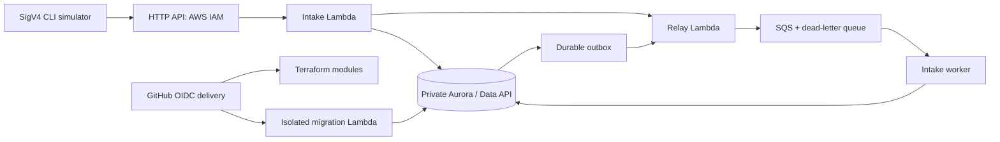

# Architecture overview

Status: foundation components are implemented; agent coordination and channels remain future components. Latest CI run determines deployment status.

ILIEN separates source request intake, case coordination, actor authorization, evidence storage, AI planning and channel delivery. A persistent case spans participants and communication channels. Replies may create child information requests; incomplete dependencies remain explicit.

The AI coordinator proposes bounded next steps. Application policies control authority, disclosure, state transitions and completion. Original messages and evidence remain distinct from interpretations and summaries. A delivered message does not establish a verified business outcome.

The initial runtime targets AWS messaging, on-demand model inference, durable queues and relational persistence. Terraform modules will manage supported infrastructure, and GitHub Actions will build and deploy versioned artifacts. A synthetic textile scenario will demonstrate material-readiness coordination; no live manufacturing system is required.

Source identity is resolved from authenticated IAM context. PostgreSQL RLS uses transaction-local tenant context and a non-owner runtime login. The migration function alone uses the managed database administrator secret. Admission stores original text/hash and the outbox intent in one transaction. Unknown valid event types are explicitly triaged. Queue delivery is at least once; duplicate handling is transactional. No exactly-once external-delivery claim is made.

The current deployment has one configured synthetic tenant, one writer and no automatic regional failover. Multiple tenant isolation is designed into keys/policies but has not been load- or penetration-tested. The foundation exposes IAM-authenticated source routes; human OIDC login and operator UI are not delivered yet.
