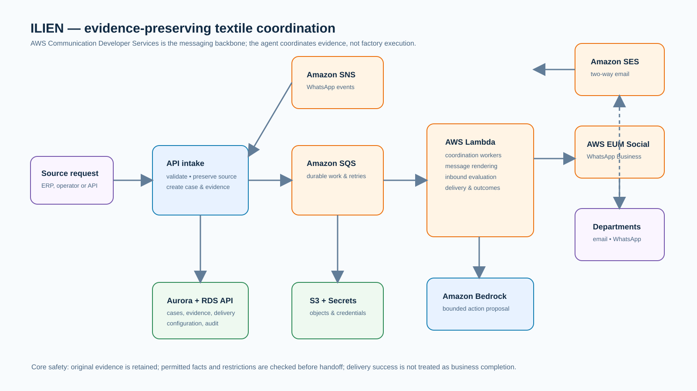

# Architecture

ILIEN is an event-driven coordination service. Its unit of work is a case: a source request plus the requirements, dependencies, contacts, evidence, delivery records, and outcomes needed to resolve the communication.

## Runtime path

1. A trusted source submits an event to the HTTP API.
2. The API stores the original event, case state, and outbox intent atomically in Aurora PostgreSQL.
3. The relay places durable work on Amazon SQS. Independent Lambda workers process intake, coordination timers, channels, results, and bounded agent runs.
4. The coordinator chooses an eligible requirement or clarification, then checks source policy, case version, contact authority, consent, deadline, and disclosure profile before a send is prepared.
5. Amazon SES and AWS End User Messaging Social carry email and WhatsApp traffic. Their inbound and provider events return through SNS/SQS and become immutable evidence and delivery records.
6. Once the current requirements are satisfied—or remain unresolved under the case policy—the service stores a source outcome and publishes it through SNS or exposes it through the authenticated result API.

## Evidence and authority boundaries

- Original source content and received message content are retained separately from extracted facts and summaries.
- A case revision and exact obligation revision stop stale replies from changing later work.
- Consent, enabled channel bindings, recipient profiles, and actor responsibility are server-side configuration; an address in a request does not grant authority.
- A failed, blocked, uncertain, or provider-accepted delivery is not silently converted into a reply or completed requirement.
- The service communicates outcomes. It does not release stock, start production, or change an ERP record.

## Bounded coordination intelligence

Amazon Bedrock is invoked by a dedicated worker with a limited case snapshot, eligible actions, fixed tool schema, call/token limits, and a timeout. The worker can propose a clarification, routing change, prerequisite, proposal, decision relay, or wait state. The deterministic coordination service validates every proposed effect against current evidence, policy, authority, consent, and revision state before it is applied. The model has no direct SES, WhatsApp, database-administration, or factory-system permission.

## Data stores

Aurora PostgreSQL holds the authoritative case aggregate and relational projections. S3 stores raw inbound channel objects; the database retains their references and hashes. Secrets Manager holds managed runtime credentials. SQS and the outbox pattern isolate transactional state changes from asynchronous calls, so a missed worker wake can be reconciled without rewriting evidence.

## Scaling and recovery

Workers are independently queue-driven, and each Lambda event-source mapping has bounded concurrency. Case updates are serialized by a case-row lock and expected revision checks. Reconciliation can re-dispatch eligible durable work; uncertain external sends require evidence-backed resolution rather than automatic resending.
