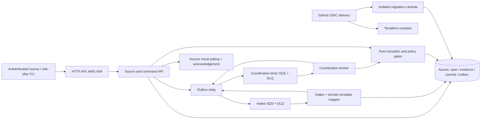

# Architecture overview

ILIEN has a deployed intake foundation and a deterministic coordination implementation. AI planning, real CDS channels and human identity/UI remain subsequent components. Latest CI determines deployed status; application verification is deferred.

Source identity is resolved from trusted IAM context. PostgreSQL RLS uses transaction-local tenant context and a non-owner runtime login. The migration worker alone uses the managed database administrator secret. Demo role-play is authorized only by a server-configured simulated connection; choosing an actor ID is not production user authentication.

`packages/coordination` separates deterministic graph transitions from transactional persistence. `packages/domain-packs` defines textile templates; it does not own provider credentials. One case row serializes concurrent transitions. Expected revisions reject stale changes; immutable command/evidence records preserve provenance. Relational obligation/dependency projections, result records and delayed-work intents commit together. Separate queue/compute modules allow intake and coordination capacity to change independently, although they share database capacity.

Only validated versioned payloads activate configured workflows. Unknown or minimal catalogue payloads stay triage. Verified simulated claims satisfy required dependencies; changed evidence invalidates dependent claims. Results describe communication outcomes, never implicit factory actions. Simulated contact snapshots are stored without actual provider delivery. [Coordination API](COORDINATION.md) documents exact behavior and bounds.

Future AI will propose bounded next steps through the same authority/version/evidence gates. Future channel adapters need real identity binding, recipient-scoped rendering, provider receipts and reconciliation before any live messaging claim. Existing simulation role-play must not be reused as production authorization.

Infrastructure is modular Terraform delivered by GitHub Actions with short-lived OIDC credentials and content-addressed private Lambda artifacts. Aurora is private and encrypted; Data API avoids permanent app connection pools. There is one configured demo tenant, one database writer and no automatic regional failover. No production scalability, security certification or tested tenant-isolation claim is made.
