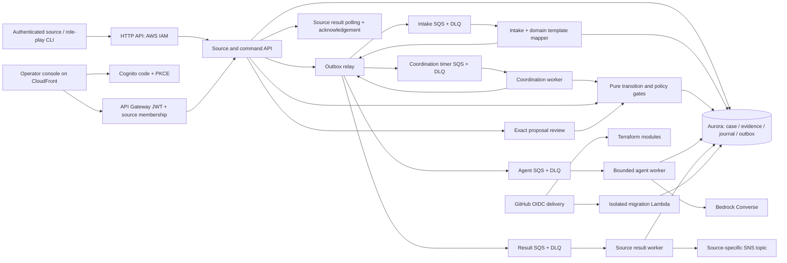

# Architecture overview

ILIEN implements intake, deterministic coordination and real AWS WhatsApp/SES adapters. A bounded Bedrock planner with mandatory operator review is implemented; production human identity/UI remains subsequent work. Latest CI determines deployed status; application verification is deferred.

Machine source identity is resolved from trusted IAM context. Browser operators use Cognito access tokens validated by API Gateway and a server-owned membership mapping; role enforcement occurs before application handlers. PostgreSQL RLS uses transaction-local tenant context and a non-owner runtime login. The migration worker alone uses the managed database administrator secret. Simulated role-play is authorized only by a server-configured simulated connection; choosing an actor ID is not production user authentication.

`packages/coordination` separates deterministic graph transitions from transactional persistence. `packages/domain-packs` defines textile templates; it does not own provider credentials. One case row serializes concurrent transitions. Expected revisions reject stale changes; immutable command/evidence records preserve provenance. Relational obligation/dependency projections, result records and delayed-work intents commit together. Separate queue/compute modules allow intake and coordination capacity to change independently, although they share database capacity.

Built-in workflows validate their versioned payload contracts; administrator-configured mappings enforce configured required top-level fields, not arbitrary domain semantics. Unknown or minimal catalogue payloads stay triage. Verified simulated claims satisfy required dependencies; changed evidence invalidates dependent claims. Results describe communication outcomes, never implicit factory actions. Contact snapshots remain separate from provider delivery intents, incoming evidence and transport events. Enabled consented bindings allow real sends. [Coordination API](COORDINATION.md) documents exact behavior and bounds.

The bounded AI worker proposes next steps through the same authority/version/evidence gates after exact-proposal operator review. See [AI architecture and limits](AI.md). The channel module supplies operator-attested identity bindings, fixed disclosure/rendering, provider receipts and conservative uncertain-send handling; scheduled reconciliation is implemented and runtime acceptance remains pending. See [channels](CHANNELS.md). Existing simulation role-play must not be reused as production authorization.

Infrastructure is modular Terraform delivered by GitHub Actions with short-lived OIDC credentials and content-addressed private Lambda artifacts. Aurora is private and encrypted; Data API avoids permanent app connection pools. There is one configured tenant, one database writer and no automatic regional failover. No production scalability, security certification or tested tenant-isolation claim is made.

Operations controls/audits and case supervision are separate from the model planner. Scheduled reconciliation, guarded recovery, asynchronous failure capture, CloudWatch monitoring and explicit held AI-trace retention are described in [operations](OPERATIONS.md). Alert delivery, recovery objectives and structural/semantic acceptance still need authorized evaluation.
