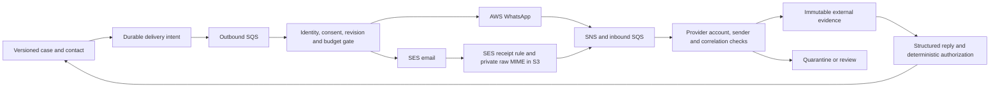

# WhatsApp and email coordination

The channel layer uses `@aws-sdk/client-socialmessaging` / `SendWhatsAppMessage` and `@aws-sdk/client-sesv2` / `SendEmail`. Real provider calls are implemented; deployment or compilation does not prove a message was delivered. Runtime acceptance is still pending. No AI interpretation runs in this release.

## Transport and evidence



Raw provider notifications are retained in immutable evidence records; notifications above 30,000 bytes use an immutable conditional-write S3 object and a hash/reference record. Normalized views above that bound are quarantined with their original retained. Email MIME is first saved to private, encrypted S3; its exact byte hash and location are recorded before parsing. Original source evidence, generated contact snapshots, actual rendered outbound text/hash, incoming evidence, delivery status events and accepted coordination commands remain separate. Operational source context stays explicitly synthetic; real participant input is marked external.

Provider acceptance, delivery/read events, participant responses and verification are different records. Out-of-order provider status events are appended rather than overwriting a purported final status. Delivery events cannot close obligations. After a timeout, crash or ambiguous provider response, delivery is `uncertain`; the sender does not automatically repeat the external side effect. Definitive provider errors become `blocked` and require operator attention. There is no exactly-once delivery claim.

## Setup

1. Configure `APP_DOMAIN`, `WHATSAPP_WABA_ID`, and `WHATSAPP_PHONE_NUMBER_ID` in GitHub Variables. AWS credentials use OIDC, not access-key secrets. The phone must already belong to an AWS-linked WABA.
2. Apply bootstrap with the same channel variables and `mail_domain=mail.<APP_DOMAIN>` so the deployment role and runtime boundary permit these resources. The project deployment creates SNS/SQS, encrypted evidence storage, SES identity/receipt rules/configuration set, workers and scoped IAM.
3. Install `terraform -chdir=infra/project output -json channel_dns_records` at the DNS provider. This creates mail-only records; it does not change the parent domain's email routing or activate the application website hostname. Sending uses `requests@mail.<APP_DOMAIN>`; each request uses an opaque `r+<token>@mail.<APP_DOMAIN>` Reply-To address. Custom MAIL FROM uses `bounce.mail.<APP_DOMAIN>` and rejects sends until its MX is ready.
4. Verify the SES domain and controlled recipient identities while the account is in the sandbox. No verification email is sent by deployment. The account's existing active SES rule set must be inspected before first apply; do not replace another application's rule set. This deployment was prepared against an account with no active set.
5. The pinned AWS Terraform provider lacks a WABA event-destination resource. `scripts/configure-whatsapp.mjs` is an explicit idempotent CI bridge to the AWS API. It installs the Terraform SNS topic only when the WABA destination is empty; it preserves and rejects conflicting existing configuration. Business registration remains external setup.
6. Establish participant consent and identity through the operator before enabling bindings. None are created from personal contacts in chat or from source event fields. With enabled bindings, subsequent eligible case contacts can send real messages.

The WhatsApp adapter currently requires an inbound message from the bound participant within the service window; it uses a conservative 23.9-hour cutoff. Outside that window it blocks. Approved template initiation is a remaining capability, not an implicit permission to send arbitrary templates. A new valid inbound message requeues requests blocked only by the closed window; send-time revision and consent checks run again.

## Authenticated operator API

All endpoints require the existing source principal's AWS SigV4 identity and are scoped to that source. The source principal acts as the operator for this synthetic deployment; it is not production human SSO. A channel address proves control of an endpoint at most, not real-world job authority. The operator attests the actor mapping and consent reference.

Use `node scripts/coordinate.mjs METHOD PATH request.json` with `ILIEN_API_URL` and AWS credentials configured. Request files containing participant addresses must remain private.

| Endpoint | Purpose |
| --- | --- |
| `POST /v1/channels/bindings` | Register/update consent and enablement for a configured actor; fields: `actorId`, `channel` (`whatsapp` or `email`), `address`, `consentRef`, `enabled`, `priority` (1–100) |
| `GET /v1/channels/bindings` | Inspect source-scoped bindings and service-window activity |
| `POST /v1/channels/dispatch` | Explicitly select another consented channel for a current contact; fields: `caseId`, `contactId`, `bindingId` |
| `GET /v1/channels/deliveries` | Last 100 delivery states, provider IDs and failure reasons |
| `GET /v1/channels/receipts` | Last 50 normalized replies, evidence IDs and review/quarantine reasons |
| `GET /v1/channels/delivery-events` | Last 100 immutable transport receipts associated with this source |

An address is uniquely bound to one actor within a source/channel. Identity cannot be silently reassigned by updating a binding. The same actor may have an email and WhatsApp binding, each with separate consent. The lowest priority number selects the initial channel. Automatic fallback based on channel failures is not implemented; an authorized operator can select another current-contact channel. Each contact can have at most one delivery per channel, and the content always comes from the coordinator, not arbitrary API text. Revocation stops future preparations; it cannot recall a send already in flight. `STOP` in an authenticated incoming channel message withdraws consent. Email bounce/complaint events suppress the associated binding.

## Replies and channel changes

The outbound message includes a random 128-bit routing token, exact subject/obligation revision and deadline. The token routes the reply; an enabled binding for the same actor is also required. A WhatsApp provider reply ID can correlate directly. Email uses the unique Reply-To address and requires passing spam/virus/DKIM/DMARC verdicts. Strict authentication intentionally quarantines forwarded or otherwise unverifiable mail.

For deterministic processing, reply with `ILIEN <token>` followed by one JSON operation from [the coordination contract](COORDINATION.md): `reply`, `verify`, or `add_child`. Email can omit that first line when using the generated Reply-To address. For a channel change, the participant can address `r+<token>@mail.<APP_DOMAIN>` from their separately consented email binding. The actor must match the original contact. The unchanged obligation revision is checked under a case lock; unrelated branch updates may advance the case revision without invalidating this reply. The existing coordinator still checks responsibility, subject revision, evidence age, dependency rules and verifier independence.

Natural language, ambiguous correlation and stale requests are preserved for review. They do not mutate workflow state. The bounded AI worker can propose an interpretation for eligible correlated unstructured replies, subject to mandatory operator review and this same deterministic boundary. See [AI](AI.md). High-impact business authorization is not established by email/phone access, and this release never executes operational actions.

## Attachments, limits and operations

Email attachments stay quarantined inside raw MIME; metadata and content hashes are recorded, and no attachment is rendered, forwarded or made publicly downloadable. WhatsApp media descriptors are retained as quarantined; files are not fetched from arbitrary URLs or treated as verified evidence. A scanner-backed release/download flow remains unimplemented. HTML is not rendered. Oversized email objects are retained in S3 without being parsed. Blanket raw-object expiration is removed in favor of held case-aware retention review; see [operations](OPERATIONS.md). An older expired object is not restored by this change, and its reference/hash must never be presented as retained readable evidence.

Initial limits: 1 MiB email parsing, 16,000-character inbound text, 4,000-byte outbound text, 100 attempted sends per tenant per rolling 24 hours, 1.5-second send reservation spacing, two concurrent workers per channel queue, bounded case/contact limits from the coordinator. Delivery intents have dispatch timestamps to bound duplicate queueing. Normal processing remains event driven. A bounded hourly safety sweep now repairs missed wakes; its wakeups add idle database cost and the interval is configurable. See [operations and recovery](OPERATIONS.md). No automatic retry of uncertain sends is allowed.

The initial inbound account mapping is one configured tenant/source/phone for this installation. A multi-customer channel-account registry, production identity lifecycle, timezone/quiet-hour policy, per-field classification configuration and full operator review UI are not claimed. These limitations are explicit rather than bypassed by an agent.

Infrastructure adds request-driven workers/queues/topics, retained S3 evidence and one rotating KMS key for SNS encryption. No new always-on compute/database is introduced. Provider message charges and the KMS key/storage have separate costs. Full channel, isolation, duplicate, outage and end-to-end acceptance remains pending.

References checked 16 October 2026: [AWS WhatsApp API](https://docs.aws.amazon.com/social-messaging/latest/APIReference/API_SendWhatsAppMessage.html), [AWS event format](https://docs.aws.amazon.com/social-messaging/latest/userguide/managing-event-destination-dlrs.html), [SNS destination permissions](https://docs.aws.amazon.com/social-messaging/latest/userguide/managing-event-destinations-add.html), [SES receipt notifications](https://docs.aws.amazon.com/ses/latest/dg/receiving-email-notifications-examples.html).

## Approved-template initiation and fallback

Outside the WhatsApp customer-service window, configuration may select an approved utility template. The sender reads the selected definition using AWS `GetWhatsAppMessageTemplate` before sending. It requires APPROVED, exact configured name/language, UTILITY category and one BODY component with this exact text:

```text
ILIEN {{1}}. Request: {{2}}. Subject: {{3}} / {{4}} / revision {{5}}. Deadline: {{6}}. Reported information (unverified): {{7}}. Source context is synthetic. Reply to this message with your response. This request authorizes no operational action.
```

Parameters are generated from the canonical contact, subject, deadline and optional claim/proposal, never a caller-supplied message. The rendered text, template definition hash, approval reference and parameters are persisted with the delivery. No template is submitted for approval automatically. A Meta-approved template matching this contract and explicit settings enablement are still required; missing/unreadable/mismatched definitions block the WhatsApp path. Inside the allowed session window the sender uses the existing text path.

`automaticFallback` is off by default. When enabled, a definitive provider rejection or unavailable session/template can create one intent on the same actor's other consented channel. It rechecks source policy version, actor, contact revision, case state and deadline; uniqueness prevents more than one attempt per contact/channel. Pending, accepted, sending or uncertain delivery is never a fallback trigger. A successful provider acceptance is not a business acknowledgement. Uncertain sends require later reconciliation; do not silently retry them.

The pending-send selection no longer filters out rows with a null `attempt_at`; only stale in-progress sends use that age threshold. Actual send verification remains deferred.

Reference: [AWS GetWhatsAppMessageTemplate](https://docs.aws.amazon.com/social-messaging/latest/APIReference/API_GetWhatsAppMessageTemplate.html).
